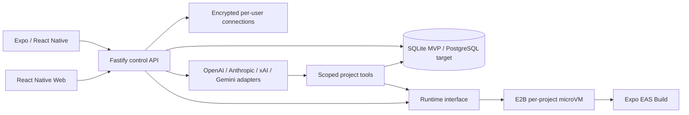

# 設計判断

作業フォルダに既存コードはなかったため、独立した新規プロジェクトとして構築。他のアプリのリポジトリは変更していません。

スマートフォンを操作UIにし、重い処理はクラウドへ送ります。ソースの正本は実行環境の寿命に依存しないDBに保持します。



管理APIはユーザーのソースを実行しません。構造化ファイル操作・テンプレート生成・履歴保存のみAPI内で行い、任意コマンドはE2Bへ送ります。

## ディレクトリ

```text
apps/mobile/         iOS・Android・Webの共通Expo UI
  src/editor.tsx     自動保存・下書き復旧・ファイル操作
  src/design.tsx     対応デザイン編集・表示
  src/workspace.tsx  AI・ツール・履歴・ビルド
apps/api/
  src/store.ts       所有権・保存・暗号化・履歴
  src/app.ts         認証済みAPI・排他制御
  src/agent.ts       AIプロバイダーとツール実行
  src/sandbox.ts     E2B・ファイル同期・EAS
packages/core/       型・スキーマ・ソース生成
docs/                設計・状況・検証
```

## 実行環境の比較

| 候補 | 長所 | 注意点 | 判断 |
|---|---|---|---|
| Docker単体 | 導入しやすい | カーネル共有。任意コードには追加隔離が必要 | 管理サーバー同居は採用しない |
| 自前VM / Firecracker | 制御範囲が広い | イメージ・スケジューラ・ネットワーク・復元を運営 | 将来の交換先 |
| E2B microVM | ライフサイクル・保存・SDKを活用 | 外部キー・利用枠・テンプレート検証が必要 | MVPの接続先 |

E2BはmicroVMベースの隔離と、一時停止・再開を提供します。実運用前にテンプレートとサービスの制限を検証します。[E2B security](https://changelog.e2b.dev/security)、[Persistence](https://docs.e2b.dev/sandbox/persistence)

外向きネットワークは既定拒否、npm・Expo等を許可リストへ。公開ポートは`allowPublicTraffic:false`。依存パッケージが別ホストを使う場合は許可リストの精査が必要です。[Internet access](https://docs.e2b.dev/network/internet-access)、[Restricting public access](https://docs.e2b.dev/network/restrict-public-access)

## モード連携

- 正本は`Project.files`。編集・デザイン・AI・ターミナルの同期先を統一。
- revisionで古い編集の上書きを拒否。AI・クラウドジョブ中は他の変更を拒否。
- 保存をスナップショット化。復元も新リビジョンとして記録。
- AIはツール呼び出しの各ラウンドを次のモデル通信前に保存する。後続APIの障害でも完了した変更を保持する。
- `design.json`から`src/HomeScreen.tsx`を生成。手動変更されたソースには視覚編集を適用しない。
- プレビューは対応デザインの投影で、実際の任意RNコードの実行ではない。

## AI

モデルIDは接続画面で指定。ツールは`list_files`、`read_file`、`write_file`、`delete_file`、`run_command`。

OpenAIとGrok（xAI）はResponses API、AnthropicはMessages API、GeminiはInteractions API（v1）。各社のモデル出力は署名・推論項目も含めて次のリクエストへ引き継ぎ、ツール結果はIDで対応付けます。OpenAI・xAI・Geminiにはstore: falseを指定します。xAIの応答待ちは最大900秒、他社は90秒です。引数を再検証し、パス・サイズ制約を全操作へ適用します。キーをプロンプトに渡しません。コマンドはユーザーが許可したリクエストだけ使用。環境作成・ビルド・公開はAIツールに含めません。[OpenAI function calling](https://developers.openai.com/api/docs/guides/function-calling)、[Anthropic tools](https://platform.claude.com/docs/en/agents-and-tools/tool-use/define-tools)

[xAI function calling](https://docs.x.ai/developers/tools/function-calling)、[Gemini function calling](https://ai.google.dev/gemini-api/docs/function-calling)、[Gemini Interactions v1](https://ai.google.dev/api/interactions-api-v1)。外部APIでの実動作はキー登録後に検証が必要です。

## プレビューと実機

PocketForge本体はEASプロジェクトへ連携済み。SDK 58ではDevelopment Buildを使い、iPhone単独の受入試験にはMetroを必要としないPreview Buildを使用する。実機試験は未完了。手順・必要設定は[IPHONE_TEST.md](IPHONE_TEST.md)を参照。

ネイティブからの接続先はHTTPSオリジンに限定し、localhost、資格情報、パス・クエリ付きURLを拒否する。接続先変更時はセッションを消去。BearerをSecureStoreへ保管し、モバイルAPI要求はCookieを認証に使わない。本番のAPIは信頼するプロキシを明示した上でHTTPSを要求する。[HTTPS構成](HTTPS_SETUP.md)は準備済みだが公開疎通は未確認。

Expo Goには固定のネイティブライブラリしか含まれません。独自ネイティブ機能や本番同等の通知にはDevelopment Buildを使います。iOS内で任意ネイティブコードを直接ロードする方式は採用しません。[Expo FAQ](https://docs.expo.dev/develop/development-builds/faq/)

実行中アプリの埋め込みプレビューには、管理APIと別のオリジン、短寿命認証、WebSocket対応プロキシが必要です。このMVPには未実装。E2Bの公開制限を解除して代用しません。

EASはクラウドでバイナリを生成しますが、アカウント・署名・アプリIDが必要です。MVPは設定済みプロジェクトへの非対話型要求と状態照会まで。[EAS setup](https://docs.expo.dev/build/setup/)

## 保存・スケール

認証情報なしでローカル検証できるよう、Node 24組み込みSQLiteを選びました。本番推奨はPostgreSQL + オブジェクトストレージ + 永続ジョブキュー。移行コードは未実装です。

排他制御は単一APIプロセスのメモリ内。再起動時、実行中ジョブを失敗として記録します。環境内で発生した未同期変更を自動回収しないため、正確なジョブ再開と分散ロックは本番準備項目です。

## 公開前に必要なサービス

1. HTTPS APIホスト、永続ディスク / PostgreSQL
2. Vaultマスターキーのシークレット管理
3. E2Bアカウントと制限済みテンプレート
4. ユーザーごとのOpenAI / Anthropic / xAI / Gemini接続
5. Expoアカウント、Apple / Android配布設定
6. 外部バックアップ・監視・オブジェクトストレージ

有料サービスは作成していません。本番デプロイも実施していません。
